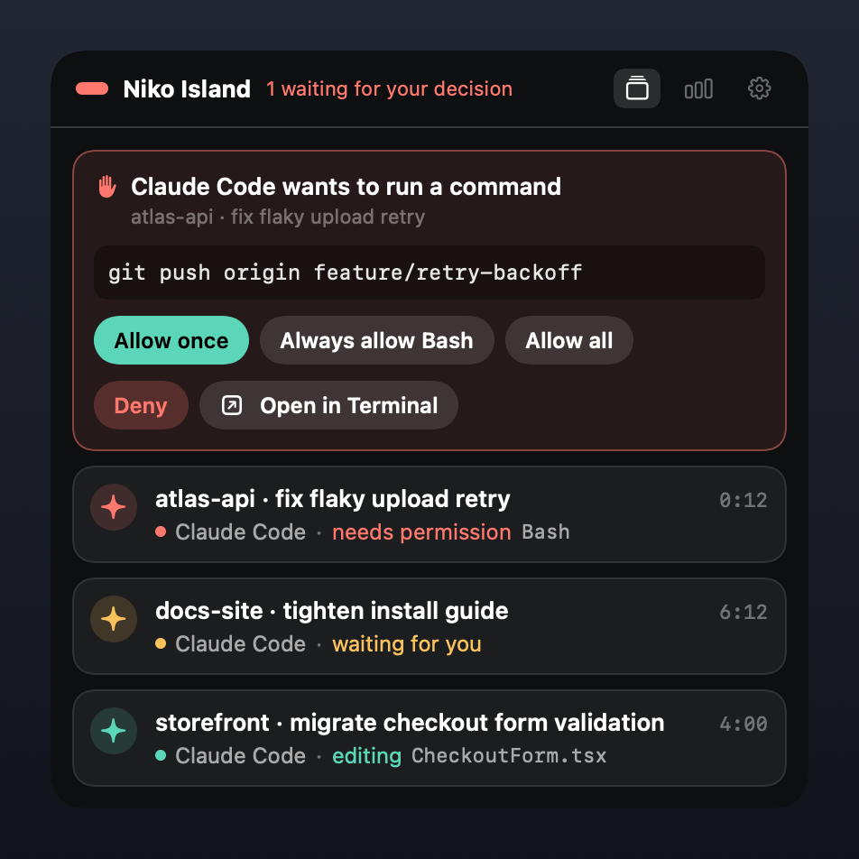
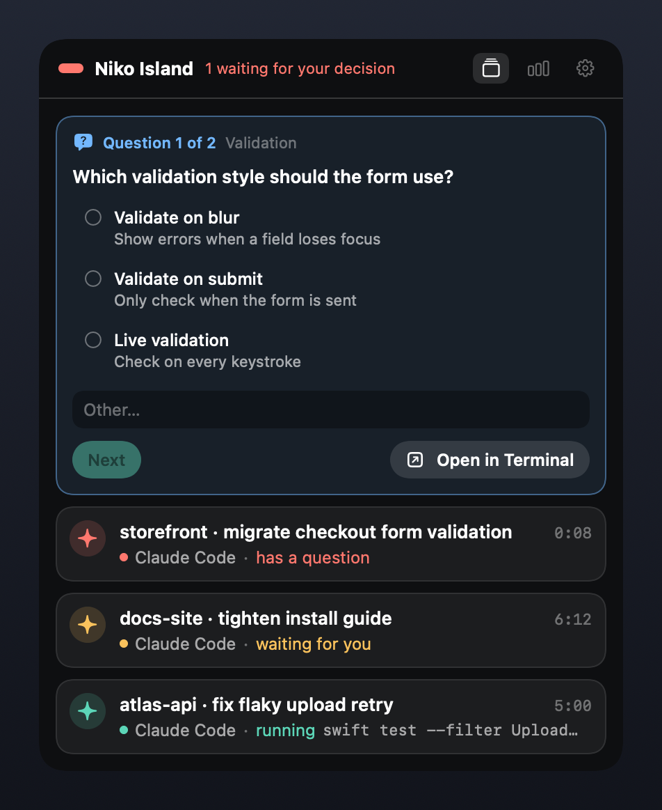
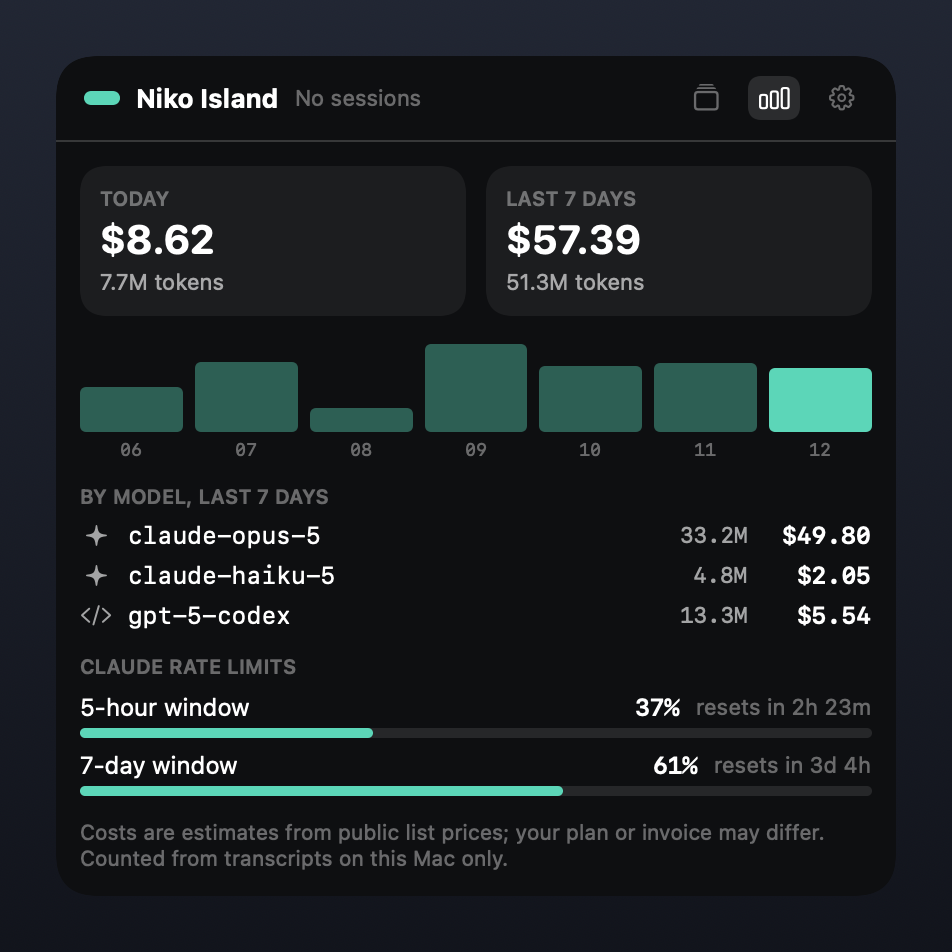

<p align="center">
  
</p>

<h1 align="center">Niko Island</h1>

<p align="center">
  <b>See what your AI coding agents are doing, and answer them, without leaving the window you are in.</b><br>
  A free, open-source menu-bar companion for macOS. No telemetry, no account, everything stays on your Mac.
</p>

<p align="center">
  <a href="https://github.com/baogutang/niko-island/releases/latest"></a>
  <a href="LICENSE"></a>
  
  <a href="https://github.com/baogutang/niko-island/actions/workflows/ci.yml"></a>
</p>

<p align="center">
  <a href="README.zh-CN.md">简体中文</a> ·
  <a href="https://baogutang.github.io/niko-island/">Website</a> ·
  <a href="https://github.com/baogutang/niko-island/releases/latest">Download</a> ·
  <a href="docs/ROADMAP.md">Roadmap</a>
</p>

<p align="center">
  
</p>
<p align="center"><sub>Rendered from the app's own views with sample sessions. Screenshots from a live desktop will replace these.</sub></p>

---

## Quick start (about 30 seconds)

1. **Download** the latest zip from [Releases](https://github.com/baogutang/niko-island/releases/latest) and unzip it.
2. **Move and open.** The app is ad-hoc signed (no Apple Developer account), so macOS needs one nudge the first time:

   ```bash
   mv "Niko Island.app" /Applications/
   xattr -cr "/Applications/Niko Island.app"   # or: right-click the app → Open → Open
   open "/Applications/Niko Island.app"
   ```

3. **Connect Claude Code.** Look at the plan first, then apply it:

   ```bash
   "/Applications/Niko Island.app/Contents/MacOS/niko-island" install --dry-run
   "/Applications/Niko Island.app/Contents/MacOS/niko-island" install
   ```

   Prefer buttons? Click the menu-bar icon → **Settings** → **Hooks** → **Connect**.

Start `claude` in any terminal. A card shows up in the panel.

After installing, `~/.niko-island/bin/niko-island` is a shortcut to the same command line.

## What it does

| | | |
|---|---|---|
| 🏝 **Live status** — one card per session: thinking, reading, editing, running `make test` | ✅ **Approvals in place** — allow once, always allow a tool, allow all for the session, deny, or send it back to the terminal | ❓ **Question wizard** — answer an agent's multiple-choice questions, single or multi-select, without switching windows |
| 🔔 **Notifications that take you back** — click one and the right Terminal.app or iTerm2 tab comes forward, tmux panes included | 📊 **Usage and cost, locally** — tokens and estimated cost per model for today and the last 7 days, read from transcripts on your disk | 🛟 **An installer you can trust** — scans first, backs up, verifies, rolls back on failure, and removes only what it added |
| 🔒 **Private by construction** — no telemetry, no account; one optional download, off by default | 🌐 **English and 简体中文** | 🧩 **More agents, opt-in** — experimental adapters for a dozen other tools |

Approvals never time out or disappear on their own. If you quit the app while an agent is waiting, the agent simply shows its own prompt.

<p align="center">
  
  
</p>

## Supported agents

| Agent | Status | What you get | What `install` touches |
|---|---|---|---|
| **Claude Code** | Stable | Live status, approvals, questions, usage, rate limits | `~/.claude/settings.json` (hook entries + status line wrapper) |
| Codex CLI | Experimental | Live status; usage from session logs | `~/.codex/hooks.json` |
| Cursor CLI | Experimental | Live status | `~/.cursor/hooks.json` |
| Copilot CLI | Experimental | Live status | `~/.copilot/hooks/niko.json` (own file) |
| Gemini CLI | Experimental | Live status | `~/.gemini/config/plugins/niko/` (own directory) |
| Grok CLI | Experimental | Live status | `~/.grok/hooks/niko.json` (own file) |
| Trae | Experimental | Live status | `~/.trae/hooks.json`, `~/.trae-cn/hooks.json` |
| Windsurf | Experimental | Live status | `~/.codeium/windsurf/hooks.json` |
| OpenCode, MiMoCode | Experimental | Live status through a small plugin; usage is best effort | `~/.config/opencode/plugins/niko.js`, `~/.config/mimocode/plugins/niko.js` (own files) |
| Qwen Code, QwenWork | Experimental | Live status | `~/.qwen/settings.json`, `~/.qwenwork/settings.json` |
| Kiro | Experimental | Live status | `~/.kiro/settings/cli.json` |
| Factory | Experimental | Live status | `~/.factory/settings.json` |
| Kimi Code, DeepSeek CLI, Droid, Pi / OhMyPi, OpenClaw, Amp | Planned | — | — |

**Stable** means wired end to end and covered by tests. **Experimental** means the adapter follows the config location and format listed in [INTEGRATIONS.md](INTEGRATIONS.md) but has **not been validated against a live copy of that agent** in this release. Experimental adapters are never installed by default:

```bash
niko-island install --agents codex,cursor   # pick some
niko-island install --all                   # every detected agent
niko-island uninstall                       # always removes everything of ours
```

In this release, approving from the panel works with Claude Code only. For the other agents the panel shows status.

## Privacy

Short version: **no telemetry, no accounts, all local.** The long version, so you can check it:

- **Nothing phones home.** There is no analytics, crash-reporting or update-check code in the app.
- **No account, no license key, no activation.**
- **One optional network request.** The app can download a public list of model prices to keep cost estimates current. It is **off by default**; switch it on in Settings or run `niko-island pricing refresh`. That is the only network code in the project.
- **Your data stays in `~/.niko-island/`:**

  ```
  ~/.niko-island/
  ├── bin/        niko-bridge and niko-statusline launchers
  ├── run/        the local socket (directory is 0700, owner-only)
  ├── cache/      rate-limit cache, optional price list
  ├── data/usage/ usage.sqlite: token counts, model names, session ids, project paths
  └── logs/       diagnostics, redacted before they are written
  ```

- **Events are trimmed before they leave the agent.** The bridge drops tool output and shortens long strings; the usage database stores numbers and identifiers, never prompts or replies.
- **Local only, owner only.** Agents talk to the app over a unix socket; the app checks the caller's user id on every message. A loopback HTTP port (127.0.0.1, bearer token in an owner-only file) is opened only if you connect an agent that needs a plugin.
- **Your credentials are never read**, stored or forwarded.
- **Auditable hooks.** Every entry the installer writes contains the text `niko-bridge`. Search your config for it at any time.
- **Diagnostics are redacted** and contain file states and counts, not file contents.

## How it compares

There are polished closed-source apps in this space. If you would rather read the code that sits between you and your agents, this is the trade:

| | Niko Island | A typical closed-source alternative |
|---|---|---|
| Price | Free | Paid license or subscription |
| Source | MIT, all of it | Not available |
| License key / activation | None | Usually required |
| Tracking | None, and you can verify that | You have to take their word |
| Direction | Issues and pull requests | The vendor's roadmap |
| Code signing | Ad-hoc: one extra click at first launch | Usually notarized |
| Agent coverage today | One stable integration, the rest experimental | Often broader |

## How it works

```
 agent hook ──▶ niko-bridge ──▶ unix socket ──▶ Niko Island (menu bar)
      ▲                                               │
      └──────── decision: allow / deny ◀──────────────┘
```

Agents already know how to run a command at each step of their work. `niko-island install` registers a tiny native program, `niko-bridge`, as that command. It forwards a slimmed-down event to the app and, for a permission request, waits for your decision. If the app is not running, or anything at all goes wrong, the bridge exits successfully and the agent carries on as if it were not there.

Details for the curious: [SPEC.md](SPEC.md) · [PROTOCOLS.md](PROTOCOLS.md) · [INTEGRATIONS.md](INTEGRATIONS.md).

## FAQ

**macOS says the app "cannot be opened" or "is damaged".**
The app is ad-hoc signed because the project has no Apple Developer account, so Gatekeeper does not recognise it. Right-click the app → **Open** → **Open** (once), or run `xattr -cr "/Applications/Niko Island.app"`. The release page lists SHA-256 checksums if you want to verify the download.

**How do I uninstall?**

```bash
~/.niko-island/bin/niko-island uninstall          # removes only entries tagged niko-bridge, restores your status line
~/.niko-island/bin/niko-island uninstall --purge  # also deletes ~/.niko-island and the config backups
```

Then drag the app to the Trash. Your agents keep working throughout. Even if you delete the app without uninstalling, the leftover hooks do nothing: they check for the bridge and exit quietly.

**What exactly does the installer change?**
Run `niko-island install --dry-run` to see. It reads your config first, writes a `*.niko-backup-<timestamp>` copy next to it, adds its entries after yours, re-reads the result to verify, and restores the original if anything does not match. Invalid or unusual config files are left untouched.

**Will this slow my agent down?**
Each hook starts one small native binary that hands off an event and returns in milliseconds. It never waits on a busy or absent app, except when you are being asked for a decision.

**What does "Allow all" do?**
It approves further requests from that one session until the session ends, you click *Stop*, or the app quits. It is kept in memory only. Questions are never auto-answered.

**Are the cost numbers exact?**
No. They are estimates from public list prices applied to the token counts in your local transcripts. Your plan or invoice may differ.

**Does it work on Intel Macs?**
The release is a universal binary. The Intel half is tested under Rosetta in CI, not yet on Intel hardware.

**What is next?**
See the [Roadmap](docs/ROADMAP.md). Validating the experimental adapters against live agents is first on the list.

## Build from source

Requires macOS 14+ and Xcode 16 or later (Swift 6).

```bash
git clone https://github.com/baogutang/niko-island.git
cd niko-island
swift test                    # the whole suite, including end-to-end tests with the real bridge
scripts/make-app.sh           # → dist/Niko Island.app, ad-hoc signed
scripts/smoke-launch.sh       # launches it against a throwaway directory
```

The manual checklist for what tests cannot cover lives in [docs/TESTPLAN.md](docs/TESTPLAN.md).

## Contributing

Issues and pull requests are welcome, especially reports from people running the experimental agents: one confirmed config format moves an adapter from experimental to stable.

## License

[MIT](LICENSE). The bundled model price list is a pruned copy of LiteLLM's public table, used under its MIT license ([notice](Assets/LITELLM-NOTICE.txt)).

Niko Island is an independent project. It is not affiliated with, endorsed by, or sponsored by any AI vendor. Product names in the table above are used only to say what the app works with.
