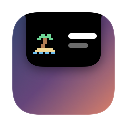
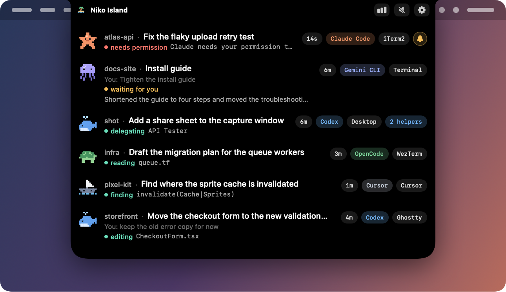
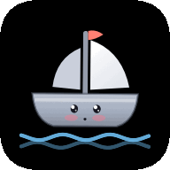
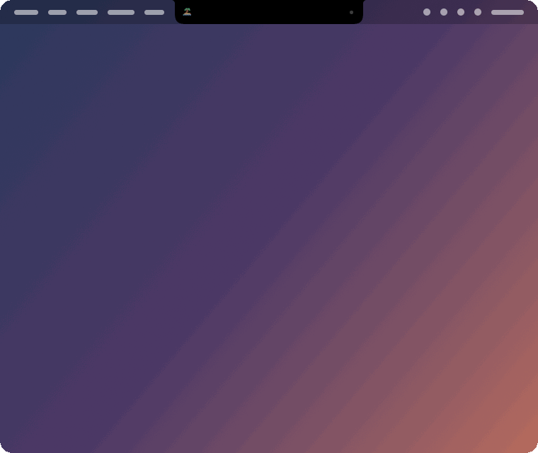
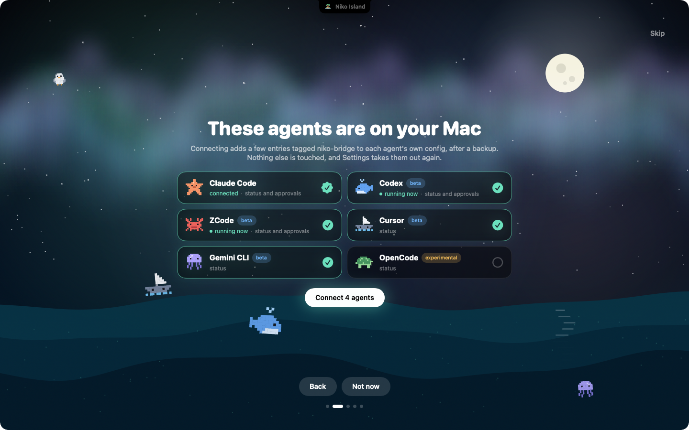
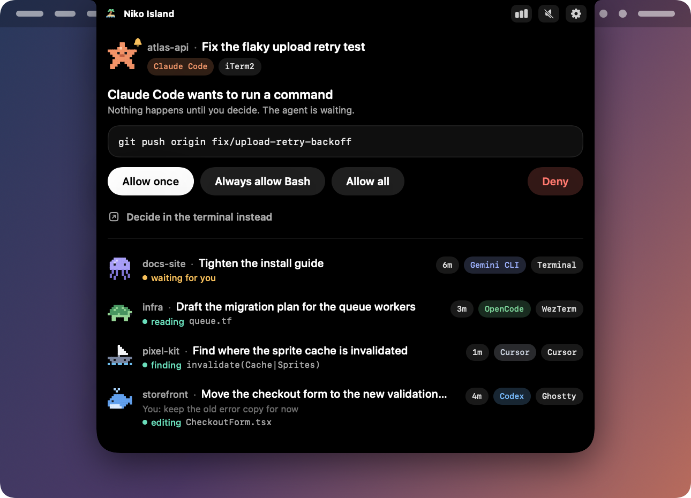
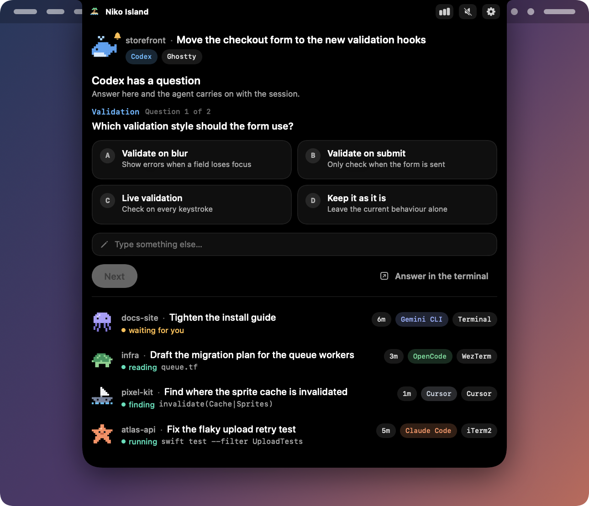
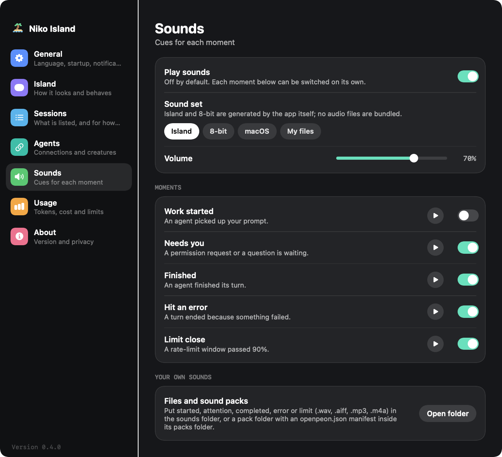
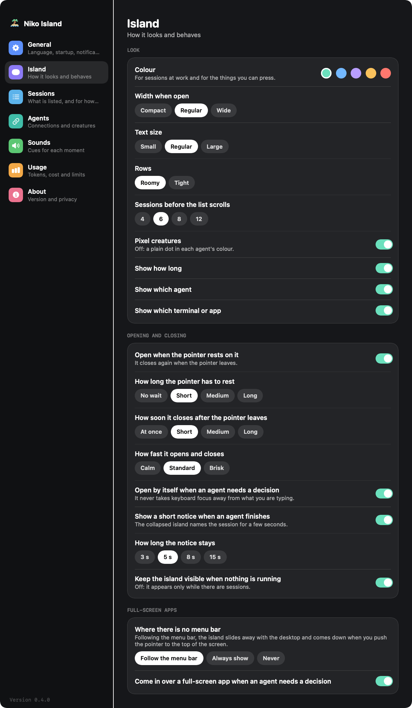
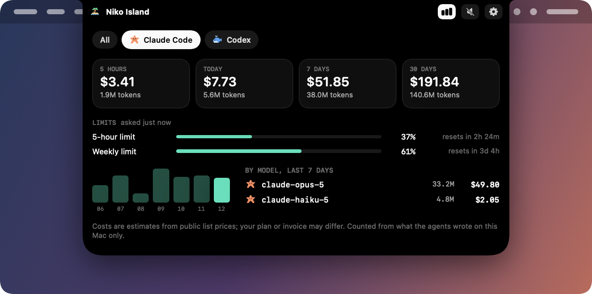

<h1 align="center">
  &nbsp;
  Niko Island
</h1>
<p align="center">
  <b>屏幕顶部的一座小岛，照看每一个替你写代码的 AI 代理。</b><br>
  <a href="https://baogutang.github.io/niko-island/">官网</a> •
  <a href="#see-it-move">演示</a> •
  <a href="#install">安装</a> •
  <a href="#features">功能</a> •
  <a href="#supported-agents">代理</a> •
  <a href="#sounds">音效</a> •
  <a href="#privacy">隐私</a> •
  <a href="#build-from-source">构建</a><br>
  <a href="README.md">English</a> | 简体中文
</p>

<p align="center">
  <a href="https://github.com/baogutang/niko-island/releases/latest"></a>
  <a href="https://github.com/baogutang/niko-island/releases"></a>
  
  
  
  <a href="LICENSE"></a>
  <a href="https://github.com/baogutang/niko-island/actions/workflows/ci.yml"></a>
</p>

<p align="center">
  
</p>

<p align="center">
  <sub>一眼看全所有会话，在当前窗口里直接批准或回答，想回去时一下跳到对应的窗口。</sub>
</p>

<p align="center">
  &nbsp;
  &nbsp;
  &nbsp;
  &nbsp;
  &nbsp;
  &nbsp;
  &nbsp;
  &nbsp;
  &nbsp;
  
</p>
<p align="center">
  <sub>Claude Code · Codex · ZCode · Cursor · Windsurf · Gemini CLI · Trae · Qwen Code · CodeBuddy · Factory · Grok CLI · OpenCode · MiMoCode · Copilot CLI · Kiro</sub>
</p>

<a id="see-it-move"></a>
## 看它动起来

空闲、工作中、请求权限、提问、完整列表、用量、完成。

<p align="center">
  
</p>

在没有摄像头挖孔的显示器上，岛屿是菜单栏上的一枚小标签：

<p align="center">
  
  
</p>

<sub>本页所有图片都由应用自身的界面代码配合示例会话渲染而成（`scripts/make-assets.sh`）。它们是渲染图，不是谁的桌面截图。</sub>

<a id="install"></a>
## 安装

### 下载发布版

1. 从 [Releases](https://github.com/baogutang/niko-island/releases/latest) 下载适合你这台 Mac 的 `.dmg`，打开后把 **Niko Island** 拖到 **Applications**（应用程序）上。

   | 你的 Mac | 下载哪个 |
   |---|---|
   | Apple 芯片（M1 及之后） | `Niko-Island-<版本>-apple-silicon.dmg` |
   | Intel | `Niko-Island-<版本>-intel.dmg` |

   不确定是哪种？打开苹果菜单 → **关于本机**：写着“芯片：Apple M…”就是 Apple 芯片，写着“处理器：…Intel…”就是 Intel。每种构建也都提供 `.zip`。不再提供通用（universal）包。
2. 清除下载隔离标记。应用采用 ad-hoc 签名（项目没有 Apple 开发者账号），所以 macOS 不会直接打开下载来的副本：

   ```bash
   xattr -cr "/Applications/Niko Island.app"
   open "/Applications/Niko Island.app"
   ```

   不想用终端？在 macOS 14 上，右键点击应用 → **打开** → **打开**。在 macOS 15 及更新版本上，先尝试打开一次，再到**系统设置 → 隐私与安全性**里点击**仍要打开**。`xattr` 命令是最稳妥的办法，因为它同时清除了代理钩子要运行的那个小助手程序上的标记；如果标记还在，**设置 → 代理**页会提示你。

3. 打开它。首次启动会出现一个全屏的欢迎引导：它会找出这台 Mac 上已有的代理，标出哪些正在运行，并接入你勾选的那些。

   <p align="center">
     
   </p>

   更喜欢终端？先看计划，再执行：

   ```bash
   "/Applications/Niko Island.app/Contents/MacOS/niko-island" install --dry-run --recommended
   "/Applications/Niko Island.app/Contents/MacOS/niko-island" install --recommended
   ```

   不带参数的 `install` 只接入 Claude Code。之后想调整：岛屿上的齿轮 → **代理** → **接入**。

应用一启动，Claude Code 和 Codex 的会话就会出现在岛上，不管有没有接入，因为应用会读取这两个代理自己写在磁盘上的会话日志。接入之后，才有来自钩子的实时状态，才能在岛上审批。接入后，`~/.niko-island/bin/niko-island` 是同一个命令行的快捷入口。

<a id="build-from-source"></a>
### 从源码构建

需要 macOS 14 及以上、Xcode 16 或更新版本（Swift 6）。

```bash
git clone https://github.com/baogutang/niko-island.git
cd niko-island
scripts/check.sh              # 全部测试
scripts/make-app.sh           # → dist/Niko Island.app（本机架构），ad-hoc 签名
scripts/smoke-launch.sh       # 在一个临时目录上启动它
open "dist/Niko Island.app"
scripts/make-release.sh       # 发布用的全部产物：apple-silicon 与 intel，各有 .dmg 和 .zip
```

## Niko Island 是什么？

编程代理大部分时间在干活，小部分时间在等你：一条要批准的命令、一个要回答的问题、一轮已经结束的对话。当代理待在被三个窗口挡住的终端标签页或应用窗口里时，这些时刻很容易错过。

Niko Island 在屏幕顶部放了一座黑色的小岛：在 MacBook 上从摄像头挖孔处长出来，在其他显示器上贴着菜单栏。代理干活时它保持小小一块，有代理需要你时它会展开，让你当场处理。它的行为就像菜单栏的一部分：菜单栏去哪，它就去哪。

<a id="features"></a>
## 功能

- **平时安静，要紧时出现。** 收起时，岛屿只显示一只小生物和几个字；只有代理卡在等你时，它才会自己展开。
- **跟着菜单栏走。** 滑到全屏应用时，岛屿会随桌面一起滑走，不会悬在你的内容上面；把指针推到屏幕顶端，它会和菜单栏一起落下来。需要你做决定的请求仍然可以出现。你来选：跟随菜单栏、始终显示，或在全屏应用上从不显示。
- **自己找到你的会话。** 直接从代理本来就写在磁盘上的记录里列出 Claude Code、Codex 和 ZCode 的会话：桌面端里的会话、在 Niko Island 启动之前就开着的会话，以及你还没接入的代理。
- **就地决定。** 允许一次、始终允许某个工具、本次会话全部允许、拒绝，或者交还给代理。没有你的明确指示，什么都不会被批准。
- **用卡片回答问题。** 选择题会变成大号选项卡片，支持单选和多选，也可以自己输入别的答案。
- **每个代理一只小生物。** Claude Code 是海星，Codex 是鲸鱼，ZCode 是螃蟹：不用读字就能分清会话。想给哪个代理换一只也可以。
- **帮你定位的小标签。** 每一行都带着时长、代理和它在哪里运行（iTerm2、Terminal、Ghostty、WezTerm、VS Code、Cursor、tmux、桌面端……）。
- **回到正确的窗口。** 点一下会话行或通知，对应的 Terminal.app 或 iTerm2 标签页就会回到前台，tmux 窗格也能定位；桌面端的会话会把对应的应用带到前台。
- **按代理分开的用量与额度。** 在全部、Claude Code、Codex、ZCode 之间切换：最近 5 小时、今天、7 天、30 天。套餐的 5 小时和每周额度来自真正知道它的地方：代理自己写下的文件，或者（在你打开开关之后）厂商本身。
- **按你的习惯来。** 强调色、宽度、文字大小、行距、显示哪些标签、悬停时间、展开收起的速度、放在哪块显示器、语言、全局快捷键（⌃⌥I）。
- **音效由你决定。** 五个时刻，两套由应用自己生成的内置音效，也可以用 macOS 系统声音、自己的文件或音效包。默认全部关闭。
- **可以放心的安装器。** 先扫描、再备份、写后校验、失败回滚，卸载时只删除自己加的内容。
- **从设计上保证隐私。** 无遥测、无账号。只有两件可选的事会用到网络，而且默认都是关闭的。
- **English 与简体中文**，可在设置里切换。

<p align="center">
  
  
</p>

<a id="supported-agents"></a>
## 支持的代理

| 代理 | 小生物 | 状态 | 你能得到什么 | 接入时会改动什么 |
|---|---|---|---|---|
| **Claude Code**（终端与桌面端） | 海星 | 稳定 | 实时状态、审批、提问、用量、速率限制。未接入时也能列出会话 | `~/.claude/settings.json`（钩子条目 + 状态栏包装） |
| Codex（CLI、IDE 扩展、桌面端） | 鲸鱼 | 测试版 | 实时状态、审批、用量、额度。未接入时也能列出会话。Codex 会要求你信任一次新钩子（`/hooks`） | `~/.codex/hooks.json` |
| ZCode | 螃蟹 | 测试版 | 实时状态、审批、用量、套餐额度（需手动开启）。未接入时也能列出会话；接入之前就开着的会话，要重开之后才会用上钩子 | `~/.zcode/cli/config.json` |
| Cursor | 小船 | 测试版 | 实时状态 | `~/.cursor/hooks.json` |
| Windsurf | 小船 | 测试版 | 实时状态 | `~/.codeium/windsurf/hooks.json` |
| Gemini CLI | 水母 | 测试版 | 实时状态 | `~/.gemini/settings.json` |
| Trae | 章鱼 | 测试版 | 实时状态 | `~/.trae/hooks.json`、`~/.trae-cn/hooks.json` |
| Qwen Code | 水母 | 测试版 | 实时状态 | `~/.qwen/settings.json` |
| CodeBuddy | 海鸥 | 测试版 | 实时状态 | `~/.codebuddy/settings.json` |
| Factory | 河豚 | 测试版 | 实时状态 | `~/.factory/settings.json` |
| Grok CLI | 河豚 | 测试版 | 实时状态 | `~/.grok/hooks/niko.json`（独立文件） |
| OpenCode、MiMoCode | 海龟 | 实验性 | 通过一个小插件提供实时状态；用量为尽力而为 | `~/.config/opencode/plugins/niko.js`、`~/.config/mimocode/plugins/niko.js`（独立文件） |
| Copilot CLI | 海鸥 | 实验性 | 实时状态 | `~/.copilot/hooks/niko.json`（独立文件） |
| QwenWork、Kiro | 水母、章鱼 | 实验性 | 实时状态 | `~/.qwenwork/settings.json`、`~/.kiro/settings/cli.json` |
| Kimi Code、Devin、Mistral Vibe、DeepSeek CLI、Pi / OhMyPi、OpenClaw、Amp | — | 计划中 | — | — |

- **稳定** — 端到端打通并有测试覆盖。
- **测试版** — 适配器写入的是该代理官方钩子文档描述的格式，并与真实安装环境里的配置文件对照过，有测试覆盖。但我们**还没有用真实的代理把它端到端跑通**。
- **实验性** — 遵循 [INTEGRATIONS.md](INTEGRATIONS.md) 中列出的配置位置和格式，尚未有人验证过。

欢迎引导和 `--recommended` 会提供稳定和测试版适配器。实验性适配器只有在你点名时才会安装：

```bash
niko-island install                         # 只接入 Claude Code
niko-island install --recommended           # 所有检测到的、有稳定或测试版适配器的代理
niko-island install --agents codex,cursor   # 挑选其中几个
niko-island install --all                   # 所有检测到的代理，包括实验性的
niko-island uninstall                       # 始终移除我们写入的全部内容
```

可以在岛屿上审批的有 Claude Code，以及测试版的 Codex 和 ZCode；其他代理在岛屿上只显示状态。

### 不靠钩子也能看到会话

钩子只在有事发生时才出声，所以空闲的会话、早就开着的会话、还没接入的代理，原本都是看不见的。（比如 ZCode 只在会话启动时读取钩子：会话开着的时候接入，这个会话就永远不会出声。）因此 Niko Island 还会读取代理自己写下的东西：Claude Code（`~/.claude/projects/`）和 Codex（`~/.codex/sessions/`）的会话日志，以及 ZCode 的会话数据库（`~/.zcode/cli/db/`）。从中得到会话的标题、正在做什么、最后一条回复，以及辅助代理。桌面端的会话就是这样出现的。

这样找到的会话可以查看、可以跳转。在岛屿上审批则需要先接入代理，因为只有钩子才能把一个请求挂起来等你决定。可以在**设置 → 会话**里关闭；同一页还能设置安静的会话保留多久。

<a id="sounds"></a>
## 音效

音效**默认关闭**。打开**设置 → 音效**，开启**播放音效**，然后只保留你在意的时刻。每个时刻旁边都有试听按钮。

| 时刻 | 何时播放 | 开启音效后是否默认启用 |
|---|---|---|
| 开始工作 | 代理接下了你的提示词 | 否（否则每条提示词都会响） |
| 需要你 | 有权限请求或提问在等你 | 是 |
| 已完成 | 代理完成了这一轮 | 是 |
| 出错了 | 这一轮因为故障而结束 | 是 |
| 额度告急 | 某个速率限制窗口超过 90% | 是 |

声音从哪里来是另一项独立的选择：

- **岛屿** — 柔和的木琴音。
- **8-bit** — 方波琶音，老式游戏机的味道。
- **macOS** — 为每个时刻挑一个系统声音。
- **我的文件** — 把你自己的 `started`、`attention`、`completed`、`error` 或 `limit` 文件（`.wav`、`.aiff`、`.mp3`、`.m4a`）放进 `~/.niko-island/sounds/`。
- **音效包** — 在 `~/.niko-island/sounds/packs/` 里放一个带 `openpeon.json` 清单的文件夹（`~/.openpeon/packs/` 里的包也会被识别）。

“岛屿”和“8-bit”是应用用几个音符现场合成的，安装包里不带任何音频文件。

<details>
<summary>音效包的目录结构</summary>

```text
~/.niko-island/sounds/packs/my-pack/
  openpeon.json
  hello.wav
  ping.mp3
  done.wav
```

```json
{
  "name": "my-pack",
  "display_name": "My Pack",
  "categories": {
    "task.acknowledge": { "sounds": [{ "file": "hello.wav" }] },
    "input.required":   { "sounds": [{ "file": "ping.mp3" }] },
    "task.complete":    { "sounds": [{ "file": "done.wav" }] }
  }
}
```

“开始工作”先找 `task.acknowledge`，再找 `session.start`。“需要你”用 `input.required`，“已完成”用 `task.complete`，“出错了”用 `task.error`，“额度告急”用 `resource.limit`。一个类别里有多个声音时随机播放一个。文件必须位于包文件夹内部，系统播放器解不了的格式会被跳过。包里没有对应声音的时刻，会退回到“岛屿”音效。

</details>

<p align="center">
  
</p>

## 设置

点击岛屿上的齿轮（或右键点击菜单栏图标）打开设置窗口。

- **通用** — 语言（English、简体中文，或跟随 macOS）、全局快捷键 ⌃⌥I、登录时启动、哪些时刻弹出通知。
- **岛屿** — *外观*：强调色、放在哪块显示器、宽度、文字大小、行距、列表滚动前显示多少个会话、小生物还是圆点、每行显示哪些标签。*展开与收起*：悬停展开以及指针要停多久、多久之后收起、动得多快、需要决定时自动展开、“已完成”提示及其停留时间、没有会话时是否保持可见。*全屏应用*：跟随菜单栏、始终显示或从不显示；需要决定的请求能否出现在全屏应用之上。
- **会话** — 是否从代理写在磁盘上的记录里找会话；安静的会话保留多久。
- **代理** — 这台 Mac 上有什么、现在谁在运行、接入一个或全部接入、移除，以及为每个代理挑一只小生物。
- **音效** — 见上文。
- **用量** — 下文的那些数字、两个“向厂商查询”的开关，以及可选的价格表刷新。
- **关于** — 版本、再看一遍欢迎引导、导出脱敏的诊断信息、退出。

<p align="center">
  
</p>

<a id="usage"></a>
## 用量

点击岛屿上的柱状图图标。

<p align="center">
  
</p>

- **按代理切换。** *全部*，或 Claude Code、Codex、ZCode 中的一个（OpenCode 为尽力而为）——只列出在这台 Mac 上留下过记录的。
- **你自己用量的四个时间窗口。** 最近 5 小时、今天、最近 7 天、最近 30 天。token 数来自你磁盘上的会话记录（`~/.claude/projects/`、`~/.codex/sessions/`、ZCode 的本地数据库，只读打开）。费用按公开标价估算；没有标价的模型只显示 token 数。
- **套餐的额度**，以及每个窗口的恢复时间。套餐用了多少，只有厂商知道，所以每个代理的数字来源不一样：

  | 代理 | 不向任何人查询时 | 打开“向厂商查询”之后 |
  |---|---|---|
  | Codex | 5 小时和每周窗口，来自 Codex 自己写的会话文件 | — |
  | Claude Code | 在终端里运行时，来自它的状态栏；被限流拒绝时，从会话记录里读到“已达上限、几点恢复”，桌面端也适用 | 5 小时和每周的百分比，用 Claude Code 存在钥匙串里的登录凭据向 Anthropic 查询 |
  | ZCode（GLM Coding Plan） | 没有：ZCode 不在本机记录这些 | 5 小时和每周的百分比，用你粘贴进来的该套餐密钥向智谱 BigModel 或 Z.ai 查询 |

  两个开关都在**设置 → 用量**里，默认关闭。向 Anthropic 查询需要 Claude Code 的登录还在有效期内：Claude Code 在终端里运行时会自己续期，桌面端不会，而 Niko Island 绝不会替它续期或改写它。登录过期时，用量页会如实说明。
- **重置是厂商自己客户端里的事。** ZCode 会发放重置卡，并在它自己的窗口里使用。对有这类功能的代理，用量页会出现**去 ZCode 重置…**按钮，作用是把那个应用带到前台。Niko Island 绝不会替你用掉一次重置；还剩几张卡只有 ZCode 的账号服务知道。

<a id="privacy"></a>
## 隐私

一句话：**无遥测、无账号、全部在本地。** 下面是可以逐条核对的完整说明：

- **不向任何地方回传数据。** 应用里没有统计、崩溃上报或更新检查的代码。
- **没有账号、没有许可证密钥、无需激活。**
- **只有两件可选的事会用到网络，默认都关闭。**（1）下载一份公开的模型价格表，让费用估算保持最新：在“设置 → 用量”里打开，或运行 `niko-island pricing refresh`。不会发送任何与你有关的信息。（2）向厂商查询你的套餐额度，见下一条。项目里没有别的联网代码，并且有一个测试专门盯着这一点。
- **你的数据都在 `~/.niko-island/`：**

  ```
  ~/.niko-island/
  ├── bin/        niko-bridge 与 niko-statusline 启动脚本
  ├── run/        本地套接字（目录权限 0700，仅本人可访问）
  ├── cache/      速率限制缓存、可选的价格表
  ├── data/usage/ usage.sqlite：token 数、模型名、会话 ID、项目路径
  ├── sounds/     你自己添加的声音文件和音效包（如果有）
  └── logs/       诊断日志，写入前已脱敏
  ```

- **事件在源头裁剪，并且只留在内存里。** 桥接程序会丢弃工具输出，并截短状态事件里的长文本。权限请求会带上相关的命令或文件，这样你才能看清自己在批准什么。这些内容都不会写入磁盘；用量数据库只保存数字和标识符，绝不保存提示词或回复内容。
- **会话日志只读取，不修改、不复制。** 为了列出会话和统计 token，应用会读取 Claude Code 和 Codex 保存在你主目录里的日志，以及 ZCode 的本地数据库（只读）。会话的标题和最后一条回复只在该行显示期间留在内存里。
- **运行中的代理在本地识别。** 为了告诉你某个代理正在运行但还没接入，应用会查看正在运行的应用和进程的名称。这份列表不会发往任何地方。
- **仅限本机、仅限本人。** 代理通过 unix 套接字与应用通信，应用会对每条消息核对调用者的用户 ID。只有当你接入需要插件的代理时，才会打开一个回环 HTTP 端口（127.0.0.1，令牌保存在仅本人可读的文件里）。
- **只有打开“向厂商查询”时才会读取登录凭据。** 打开**向 Anthropic 查询**后，应用会读取 Claude Code 存在钥匙串里的登录凭据（macOS 可能会先询问你），只放在内存里，并发送到 `api.anthropic.com` 查询额度。打开**向智谱 BigModel / Z.ai 查询**后，应用会把你粘贴的密钥（以 Niko Island 自己的名义存在钥匙串里）发送到 `open.bigmodel.cn` 或 `api.z.ai`。每项只发往对应的那一个主机；不续期、不改写、不复制任何东西；只保存百分比和恢复时间。两个开关都关闭时（出厂状态），任何登录凭据或密钥都不会被读取。ZCode 自己保存的登录信息由 ZCode 加密，我们绝不触碰。
- **钩子可审计。** 安装器写入的每一条都包含 `niko-bridge` 字样，随时可以在配置里搜索。
- **诊断信息经过脱敏**，只包含文件状态和计数，不包含文件内容。

## 与其他方案的对比

这个领域里有打磨精良的闭源应用。如果你更希望能读到夹在你和代理之间的每一行代码，下面是取舍：

| | Niko Island | 典型的闭源方案 |
|---|---|---|
| 价格 | 免费 | 付费许可或订阅 |
| 源代码 | MIT，全部公开 | 不公开 |
| 许可证密钥 / 激活 | 无 | 通常需要 |
| 追踪 | 没有，并且你可以自己验证 | 只能相信对方的说法 |
| 发展方向 | Issue 与 Pull Request | 厂商的路线图 |
| 代码签名 | ad-hoc：首次启动多一步 | 通常已公证 |
| 目前的代理覆盖 | 一个稳定集成，其余为测试版或实验性 | 往往更广 |

## 工作原理

```
 代理钩子 ──▶ niko-bridge ──▶ unix 套接字 ──▶ Niko Island ◀── 磁盘上的会话日志
     ▲                                             │              （只读）
     └────────── 决定：允许 / 拒绝 ◀────────────────┘
```

代理本来就支持在工作的每一步运行一条命令。`niko-island install` 把一个很小的原生程序 `niko-bridge` 注册为这条命令。它把精简后的事件转发给应用；遇到权限请求时，等待你的决定。如果应用没有运行，或者出了任何问题，桥接程序都会以成功状态退出，代理会像它不存在一样继续工作。

第二条路不需要代理配合：每隔一两秒，应用看一眼有变化的会话日志的末尾，这就足以知道有哪些会话、它们在做什么。

跟随菜单栏用了两个窗口。一个属于你的桌面，滑动切换时随桌面一起移动；另一个属于全屏应用，那个空间的菜单栏露出多少，它就移动多少。做这件事不需要“屏幕录制”或“辅助功能”权限。

想了解细节：[SPEC.md](SPEC.md) · [PROTOCOLS.md](PROTOCOLS.md) · [INTEGRATIONS.md](INTEGRATIONS.md)。

## 验证了什么、没验证什么

下面如实说明检查做到了哪一步。

| 已验证 | 方式 |
|---|---|
| 协议、桥接程序、安装器、审批、提问、用量引擎、会话发现、菜单栏定位、厂商额度查询、音效合成与音效包 | 约 300 个自动化测试，包括使用真实桥接程序的端到端测试、故障注入和 100 会话压测 |
| 真实桌面上的岛屿 | 在 macOS 15、一台没有摄像头挖孔的外接显示器上试过：悬停、点击、各个设置页和用量视图；欢迎引导按显示器的原始分辨率截图，确认画面是清晰的；滑到全屏应用再滑回来、全屏下菜单栏落下、请求出现在全屏应用之上，这几项都录了屏并逐帧检查 |
| 不靠钩子的会话 | Claude、Codex 和 ZCode 桌面端的会话（包括 Codex 的辅助代理）在没有任何钩子为它们触发的情况下出现在了岛屿上 |
| 在真实配置上运行安装器 | 在一份真实 `settings.json` 的私有副本上做了往返测试（其中已有其他工具的钩子和状态栏）：外来内容没有任何改动，卸载后与原文件逐字节一致。各代理的格式与 Codex、ZCode、Cursor、Windsurf、Gemini CLI、Trae 真实安装环境里的配置文件对照过 |
| 用量数字 | 约 1 GB 真实 Claude Code 会话记录的合计值，与独立重新统计的结果完全一致；Codex 会话与其自身的累计值相符 |
| 速度 | 冷启动到接收第一个事件不到一秒；每个钩子约 25 毫秒 |
| 两个发布构建 | `scripts/make-release.sh` 构建 Apple 芯片版和 Intel 版，检查架构和签名，解压 zip、挂载磁盘映像；Intel 版在 Rosetta 下可以启动并通过启动测试 |

| 尚未验证 | 原因 |
|---|---|
| MacBook 自带的显示器、同时接两块显示器、桌面上设置为自动隐藏的菜单栏 | 开发时只有一块外接显示器；带摄像头挖孔的布局目前只存在于渲染图里 |
| 在岛屿上批准真实代理发来的请求 | 测试里的请求来自一个遵循公开钩子约定的模拟代理。对真实代理，状态已经看到过，但还没有真正点过一次批准。见 [docs/TESTPLAN.md](docs/TESTPLAN.md) 第 10 节 |
| 任何一个测试版适配器配合真实代理 | 见上表 |
| 用有效的登录向 Anthropic 查询额度 | 在试用的那台机器上，Claude Code 的登录已经过期（只用桌面端），所以解析这条路径用的是 Claude Code 自己缓存下来的格式，而不是一次真实的返回 |
| 向智谱 BigModel / Z.ai 查询额度 | 需要密钥的主人自己输入；按多个开源工具记录的返回格式编写，从未对真实服务运行过 |
| 内置音效实际听起来如何 | 它们由代码合成，测试只覆盖了格式、时长和音量。还没有人真正听过 |
| 点击通知或会话行跳回 Terminal.app、iTerm2 和 tmux | 需要有人在屏幕前操作；当时没有 iTerm2 |
| 在另一台 Mac 上用浏览器下载并经过 Gatekeeper | 发布文件是在命令行里下载核对的，这种方式不会带上隔离标记 |
| Intel 硬件、全新的 macOS 账户 | 没有条件；Intel 版只在 Rosetta 下运行过 |
| 任何一个实验性代理 | 见上表 |

如果第二张表里的哪一项让你踩了坑，请提一个 Issue。

## 常见问题

**macOS 提示应用“无法打开”或“已损坏”。**
因为项目没有 Apple 开发者账号，应用采用 ad-hoc 签名，Gatekeeper 不认识它。运行一次 `xattr -cr "/Applications/Niko Island.app"` 即可。不用终端的话：在 macOS 14 上，右键点击应用 → **打开** → **打开**；在 macOS 15 及更新版本上，先尝试打开，再到**系统设置 → 隐私与安全性 → 仍要打开**。发布页提供 SHA-256 校验和，可以先核对下载文件。

**我该下载哪一个？**
M 系列芯片的 Mac 下载 `apple-silicon`，Intel 处理器的 Mac 下载 `intel`（苹果菜单 → 关于本机可以看到）。下错了要么打不开，要么在 Rosetta 下跑得更慢。

**应用能运行，但岛屿上没有小生物。**
Claude Code 和 Codex 的会话几秒钟内就能从日志里找到，所以先确认**设置 → 会话**里的“通过读取代理自己的会话日志来发现会话”是开着的。如果是已接入的代理没有动静，运行 `~/.niko-island/bin/niko-island doctor`：最常见的原因是应用包上的隔离标记还在，导致钩子无法启动助手程序，`doctor` 会给出用于修复的那条 `xattr` 命令。Codex 还需要你信任一次新钩子（`/hooks`）。

**为什么 Claude Code 或 ZCode 没有额度？**
因为这台 Mac 上没有任何地方知道它。Codex 会把额度写进自己的会话文件；Claude Code 和 ZCode 的额度只存在厂商那边。“设置 → 用量”里各有一个开关，可以用你自己的登录或密钥直接向厂商查询。对 Claude Code 来说，这需要登录仍在有效期内——如果你也在终端里用它，通常就是有效的。见[用量](#usage)。

**“重置”按钮去哪了？**
0.3.0 里它只是开始一个本地计数，这并不是任何人理解的“重置”。额度重置是在厂商自己的应用里使用的；对 ZCode，用量页有一个把它带到前台的按钮。

**会话列出来了，但不能在岛屿上审批。**
这一行来自会话日志。请接入该代理（设置 → 代理）并重开会话：只有钩子才能把请求挂起来等你决定。

**岛屿出现在全屏应用上面了 / 我就想让它在那儿。**
设置 → 岛屿 → 全屏应用：*跟随菜单栏*（默认）、*始终显示*或*从不*。另外还可以单独选择，需要你做决定的请求能否出现在全屏应用之上。

**如何卸载？**

```bash
~/.niko-island/bin/niko-island uninstall          # 只移除带 niko-bridge 标记的条目，并恢复你的状态栏
~/.niko-island/bin/niko-island uninstall --purge  # 同时删除 ~/.niko-island 和配置备份
```

然后把应用拖进废纸篓。整个过程中你的代理都能照常工作。即使没有卸载就直接删除了应用，残留的钩子也什么都不会做：它们检查不到桥接程序就会安静退出。

**安装器到底会改什么？**
运行 `niko-island install --dry-run` 就能看到。它会先读取你的配置，在旁边写一份 `*.niko-backup-<时间戳>` 备份，把自己的条目追加在你的条目之后，再重新读取结果进行校验，只要有任何不一致就恢复原样。格式无效或结构特殊的配置文件一律不动。

**岛屿挡着我了。**
在“设置 → 岛屿”里关掉“指针停在上面时展开”（或者把停留时间调长），它就只在你点击或代理需要你时展开；关掉“没有会话时也保持岛屿可见”，空闲时它会消失。点击其他任何地方都能把它收起，而且这绝不会替你对等待中的请求做决定。

**它会读我的对话内容吗？**
它会读取磁盘上会话日志的末尾，用来显示会话的标题、正在做什么以及最后一条回复。这些文字只在该行显示期间留在内存里，不会写到任何地方，也不会离开你的 Mac。可以在“设置 → 会话”里关闭。

**会拖慢代理吗？**
每个钩子只启动一个很小的原生程序，交出事件后就退出：在 Apple 芯片的 Mac 上用发布版实测，每个钩子约 25 毫秒，应用是否在运行都一样。只有在需要你做决定时它才会等待。

**“全部允许”是什么意思？**
它会批准这一个会话之后的请求，直到会话结束、你点击“停止”或应用退出为止。它只保存在内存里。提问永远不会被自动回答。

**费用数字精确吗？**
不精确。它是用公开标价乘以本地会话记录里的 token 数得到的估算值，可能与你的套餐或账单不同。

**接下来做什么？**
见[路线图](docs/ROADMAP.md)。排在最前面的是用真实的代理把各个测试版适配器跑通，以及在 MacBook 自带的显示器上试用岛屿。

## 参与贡献

欢迎提交 Issue 和 Pull Request，尤其欢迎正在使用测试版和实验性代理的朋友反馈：每确认一次完整的往返，就能把一个适配器升一级。测试覆盖不到的部分，手动检查清单在 [docs/TESTPLAN.md](docs/TESTPLAN.md)。

## 致谢

把刘海区域用作编程代理的界面，并不是我们的发明。此前已有多个项目做过探索，它们塑造了大家对这类工具的期待。Niko Island 的代码、图形、音效和文字均为原创。

## 许可

[MIT](LICENSE)。随附的模型价格表是 LiteLLM 公开价格表的裁剪版，依据其 MIT 许可使用（[声明](Assets/LITELLM-NOTICE.txt)）。

Niko Island 是独立项目，与任何 AI 厂商均无隶属、认可或赞助关系。上表中的产品名称仅用于说明本应用可以配合哪些工具使用。
